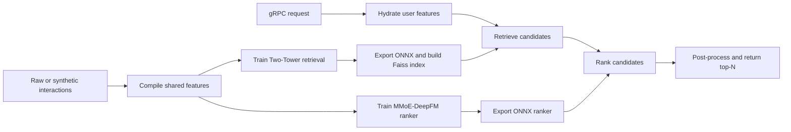

# RecallRank — Two-Stage Neural Recommendation System

A Python monorepo demonstrating a two-stage recommendation workflow: retrieve candidate items with a Two-Tower model, then rank them with a multi-task MMoE-DeepFM model. The project includes synthetic data generation, model training, ONNX export, a Faiss index, a feature store, and a gRPC serving application.

> This repository is a runnable reference implementation using synthetic data. Its outputs are for demonstration and are not production recommendations.

## Architecture



The same `FeatureProcessor` is used for offline feature compilation and online serving to help keep transformations consistent. The online flow retrieves candidates, scores them, and applies post-processing before returning recommendations.

## Packages

| Package | Responsibility |
|---|---|
| `recsys-common` | Shared schemas, vocabularies, and feature transformations |
| `recsys-data` | Synthetic data generation and dataset compilation |
| `recsys-retrieval` | Two-Tower model, training, loss, and Faiss index |
| `recsys-ranking` | MMoE-DeepFM model and ranking metrics |
| `recsys-serving` | gRPC service, feature store, ONNX inference, and post-processing |

## Requirements

- Python 3.11 or newer
- [uv](https://docs.astral.sh/uv/) for workspace/dependency management

## Install

From the repository root:

```bash
uv sync
```

Optionally enable the configured pre-commit hooks:

```bash
uv tool install pre-commit
pre-commit install
```

## Run the full workflow

Run each step from the repository root, in order:

```bash
# 1. Generate synthetic data and compile shared features
uv run python scripts/generate_data.py

# 2. Train and export the retrieval model
uv run python scripts/train_retrieval.py

# 3. Train and export the ranking model
uv run python scripts/train_ranking.py

# 4. Build the Faiss item index
uv run python scripts/build_index.py

# 5. Populate the feature store
uv run python scripts/populate_feature_store.py

# 6. Start the gRPC server
uv run python scripts/serve.py
```

Training can also be run with explicit configuration files:

```bash
uv run python scripts/train_retrieval.py --config configs/retrieval.yaml
uv run python scripts/train_ranking.py --config configs/ranking.yaml
```

The server listens on the configured gRPC address (the example client uses localhost port `50051`). With the server running, send a test request from another terminal:

```bash
uv run python scripts/example_client.py --user-id user_42
```

Check each script's `--help` output for additional options, including checkpoint/resume arguments.

## Models and serving behavior

### Retrieval

The Two-Tower model encodes users and items into vectors. Training uses in-batch negatives with InfoNCE loss and popularity correction. The item embeddings are indexed with Faiss for maximum-inner-product candidate retrieval.

### Ranking

The MMoE-DeepFM ranker shares expert networks across tasks and uses task-specific gates and output heads for click-through rate (CTR) and conversion rate (CVR). The CVR loss is masked to clicked examples. Optional DCN cross-layers can be enabled in the ranking configuration.

The serving pipeline combines predictions with item price to compute expected-value scores, then applies deduplication, diversity limits, and configured business rules. Review the configuration and source before interpreting the score as a business objective.

### Online/offline features

Dataset compilation creates shared vocabulary and normalization artifacts used by model training and serving. Keep these artifacts paired with the models and index produced from the same training run.

## Tests and code quality

Run the complete test suite:

```bash
uv run pytest
```

Run package-specific or integration tests:

```bash
uv run pytest tests/common/
uv run pytest tests/data/
uv run pytest tests/retrieval/
uv run pytest tests/ranking/
uv run pytest tests/serving/
uv run pytest tests/integration/
```

Run the configured lint and type checks:

```bash
uv run ruff check .
uv run mypy packages/
```

## Repository layout

```text
configs/       Training configuration files
packages/      Workspace packages listed above
proto/         gRPC service definition
scripts/       Data, training, index, serving, and client entry points
tests/         Unit and integration tests
```

## Extending the example

- Replace synthetic data generation with your own licensed dataset while preserving the compilation artifact format expected by the training and serving code.
- Add or change features through the shared schemas and `FeatureProcessor`; regenerate the associated vocabularies and statistics.
- `VectorIndex` and `FeatureStore` are protocol-based interfaces intended to support alternative index and storage implementations.
- Review dataset privacy, model quality, latency, security, and deployment requirements before adapting this example to real users.

## Credits and license

The upstream project identifies **Umesh Gehlot** as its author. that documentation credit does not change the attribution of the underlying project.

Licensed under the MIT License; see [LICENSE](LICENSE). Third-party dependencies and model artifacts remain subject to their own licenses and terms.
